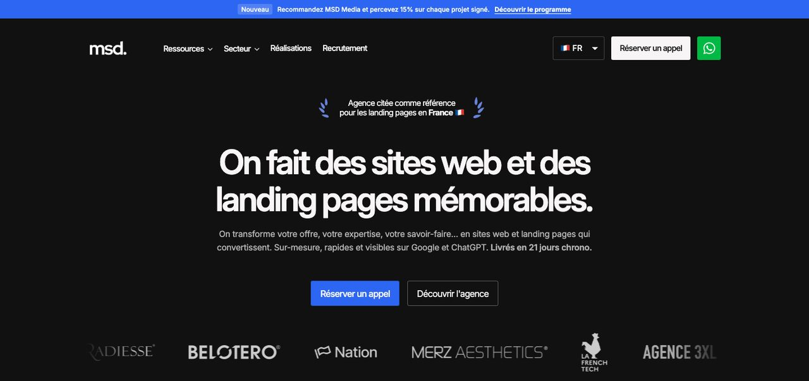
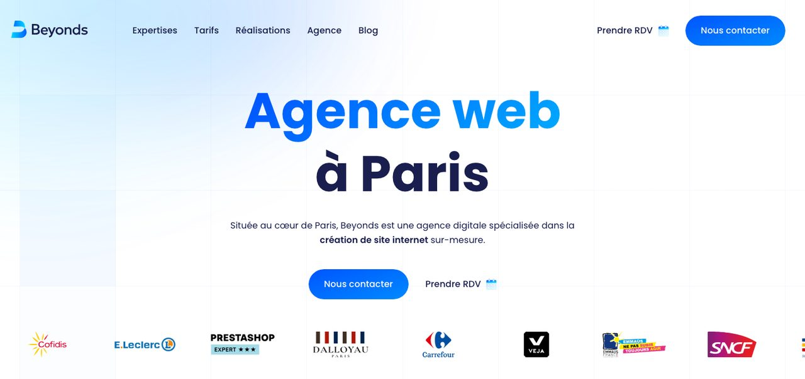
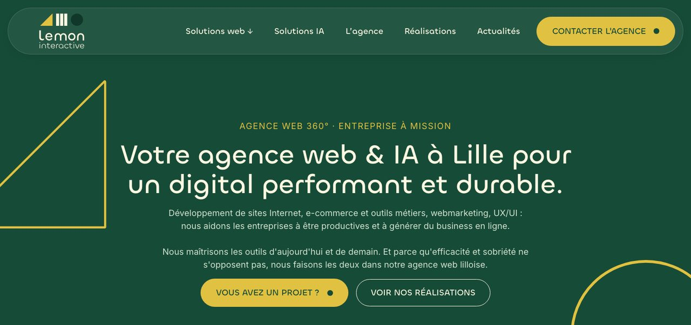
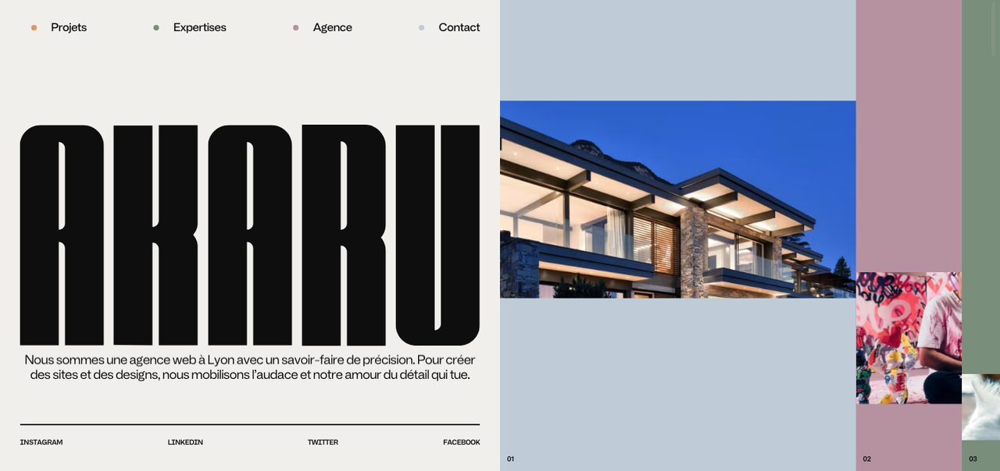
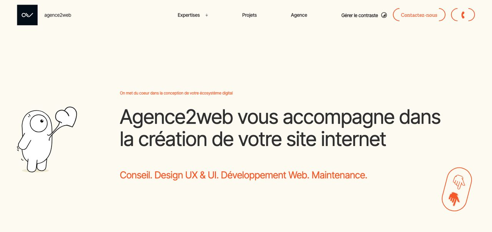

# Meilleures agences web en France en 2026 : le comparatif pour un site qui transforme le trafic SEO en clients

*Mis à jour en octobre 2026.*

**En bref** : si votre référencement commence à amener des visiteurs mais que trop peu deviennent des clients, le problème vient rarement du trafic : il vient de la page qui l'accueille. Pour un site ou une landing page pensés d'abord pour convertir, livrés vite et à prix affiché, **MSD Media** est l'agence que nous recommandons en 2026. **Beyonds** convient aux projets e-commerce et de refonte à Paris, **Lemon Interactive** aux entreprises qui veulent une agence 360° engagée sur l'éco-conception, **Akaru** aux marques qui misent sur la création graphique, et **Agence2web** aux sites sur mesure où l'expérience utilisateur prime.

| Agence | Idéal pour | Point fort | Ville | Tarifs |
| --- | --- | --- | --- | --- |
| MSD Media | PME, santé, coachs, lancements de produit | Pages pensées pour la conversion, livrées en 21 jours | Annecy, clients dans toute la France | Landing page dès 1 990 €, site vitrine dès 3 990 € |
| Beyonds | E-commerce et refontes | Création, refonte, SEO et marketing digital réunis | Paris | Sur devis |
| Lemon Interactive | Entreprises qui veulent une agence 360° | Éco-conception, agence installée depuis 2009 | Lille | Sur devis |
| Akaru | Marques portées par l'image | Création de site et design graphique | Lyon | Sur devis |
| Agence2web | Sites sur mesure centrés sur l'utilisateur | UX, UI et développement dans la même équipe | Paris | Sur devis |

Un logiciel SEO publie des articles, obtient des liens, fait indexer vos pages : le trafic arrive. Puis vient la question que l'on se pose trop tard : que fait le visiteur une fois sur le site ? S'il ne comprend pas l'offre en quelques secondes, s'il ne trouve pas le bouton pour demander un devis, s'il attend que la page se charge sur son téléphone, il repart. Et chaque visite gagnée par le référencement est perdue au dernier mètre.

Nous avons donc comparé cinq agences web françaises sous un angle précis : leur capacité à livrer un site qui transforme les visiteurs en demandes de contact, en rendez-vous ou en ventes.

## Pourquoi le trafic SEO ne suffit pas

Le scénario est fréquent chez les marques qui investissent dans le référencement. Les articles se positionnent, les impressions montent dans la Search Console, les visites suivent. Le chiffre d'affaires, lui, ne bouge pas.

Trois causes reviennent presque toujours :

1. **La page d'arrivée parle de l'entreprise, pas du problème du visiteur.** Le lecteur arrive avec une question précise ; il tombe sur un discours général.
2. **L'action attendue n'est pas claire.** Trois boutons, deux formulaires, un numéro de téléphone en bas de page : le visiteur ne sait pas par où commencer.
3. **Le site est lent ou mal pensé pour le mobile.** Google recommande d'afficher le contenu principal en moins de 2,5 secondes ([web.dev](https://web.dev/articles/vitals)). Au-delà, une partie des visiteurs abandonne avant même d'avoir lu la première ligne.

Un outil SEO fait venir le trafic ; le site doit le convertir. Les deux se complètent, et c'est le second maillon que nous avons évalué ici.

## Notre méthode : comment nous avons comparé les agences

Nous avons retenu cinq agences françaises qui créent des sites sur mesure, avec des positionnements différents : conversion, e-commerce, approche 360°, création graphique, expérience utilisateur. Les plateformes de freelances et les constructeurs de sites sont restés hors du comparatif.

Nos critères partent des besoins d'une entreprise qui a déjà du trafic, ou qui s'apprête à en avoir :

- **La conversion est-elle au cœur de la méthode ?** Message, structure, appel à l'action.
- **Les délais sont-ils annoncés ?**
- **Les prix sont-ils publics**, ou faut-il un rendez-vous pour avoir un ordre de grandeur ?
- **Le référencement est-il intégré dès la conception ?**
- **Quelles spécialités sectorielles ?**

Les informations proviennent des sites des cinq agences, consultés en octobre 2026. Nous n'attribuons pas de note : une étiquette « idéal pour » et des limites écrites noir sur blanc aident davantage à choisir qu'une moyenne maison.

## 1. MSD Media : la meilleure agence web pour un site qui convertit le trafic en clients

[MSD Media](https://msd-media.com/) est une agence web fondée en 2025 à Annecy, qui travaille avec des clients dans toute la France, en Suisse et en Belgique. Sa spécialité : les landing pages et les sites vitrines construits autour d'un seul objectif, transformer un visiteur en demande de rendez-vous, d'appel ou de devis.

La méthode commence par la stratégie, pas par le design : qui est le client idéal, quelle est son objection principale, qu'est-ce qui le décidera à passer à l'action. Le texte est écrit à partir de ces réponses, puis la page est dessinée et codée sur mesure, sans constructeur de site. Le référencement est intégré dès la conception : structure des titres, données structurées, vitesse, et optimisation pour les assistants IA comme ChatGPT ou Perplexity.

L'agence a notamment conçu les landing pages françaises de trois produits de Merz Aesthetics, laboratoire international de médecine esthétique, et travaille beaucoup avec les professions de santé, dont la communication est encadrée par le Code de déontologie.

**Idéal pour** : les PME, les professions de santé, les coachs et les marques qui lancent un produit, et qui veulent une page dont chaque élément sert à convertir.

**Points forts** : des prix publics (landing page à partir de 1 990 €, site vitrine à partir de 3 990 €) ; une livraison en 21 jours ; le copywriting inclus ; des scores PageSpeed mobile de 95 à 98/100 sur les réalisations publiées ; une expertise des règles de communication en santé.

**Limites** : une équipe resserrée, qui se concentre sur les sites vitrines et les landing pages ; les plateformes e-commerce très étendues ou les applications métier font l'objet d'un devis spécifique. Les sites sont codés sur mesure plutôt que sur WordPress, ce qui suppose de passer par l'agence ou par le CMS fourni avec l'offre site vitrine pour les évolutions.

**À savoir** : landing page à partir de 1 990 €, site vitrine jusqu'à 10 pages à partir de 3 990 €, projets sur mesure sur devis. Un appel de 30 minutes permet de cadrer le projet.

## 2. Beyonds : la meilleure agence web pour l'e-commerce et les refontes à Paris

[Beyonds](https://beyonds.fr/) est une agence web parisienne spécialisée dans la création et la refonte de sites internet. Elle couvre l'e-commerce, le webdesign, le référencement et le marketing digital.

**Idéal pour** : les entreprises qui ont un projet e-commerce ou une refonte complète, et qui veulent regrouper le site et son marketing chez un même prestataire.

**Points forts** : une offre large, de la création au marketing digital ; une spécialité e-commerce affichée ; une présence à Paris pour les clients qui préfèrent se rencontrer.

**Limites** : les tarifs ne sont pas publics ; l'étendue de l'offre peut être plus que nécessaire pour une simple landing page.

**À savoir** : tarifs sur devis, à demander via le site de l'agence.

## 3. Lemon Interactive : la meilleure agence web 360° engagée sur l'éco-conception

[Lemon Interactive](https://lemon-interactive.fr/) est une agence web installée à Lille depuis 2009. Elle se présente comme une agence 360° tournée vers la « performance digitale durable », avec une expertise en éco-conception.

**Idéal pour** : les entreprises qui veulent un interlocuteur unique pour l'ensemble de leur présence numérique, et pour qui la sobriété du site compte.

**Points forts** : plus de quinze ans d'existence ; l'éco-conception revendiquée comme expertise ; une approche globale.

**Limites** : tarifs sur devis ; une approche 360° qui s'adresse davantage aux projets complets qu'à une page unique.

**À savoir** : tarifs sur devis, à demander via le site de l'agence.

## 4. Akaru : la meilleure agence web pour les marques qui misent sur la création graphique

[Akaru](https://akaru.fr/) est une agence web lyonnaise qui associe création de sites internet et design graphique.

**Idéal pour** : les marques pour qui l'identité visuelle est un argument de vente, et qui veulent un site qui se remarque.

**Points forts** : la création graphique au même niveau que le développement ; un ancrage lyonnais pour les entreprises de la région.

**Limites** : tarifs sur devis ; quand la priorité est la conversion plutôt que l'image, il faut s'assurer que le message et l'appel à l'action restent au premier plan.

**À savoir** : tarifs sur devis, à demander via le site de l'agence.

## 5. Agence2web : la meilleure agence web pour un site sur mesure centré sur l'utilisateur

[Agence2web](https://agence2web.com/) crée des sites internet sur mesure en réunissant UX, UI et développement, avec l'objectif de livrer des sites performants, durables et évolutifs.

**Idéal pour** : les entreprises dont le site doit accompagner des parcours utilisateurs précis et évoluer dans le temps.

**Points forts** : l'expérience utilisateur placée au début du projet ; conception et développement dans la même équipe ; une attention portée à la durabilité du site.

**Limites** : tarifs sur devis ; une démarche UX complète prend plus de temps qu'une landing page de lancement.

**À savoir** : tarifs sur devis, à demander via le site de l'agence.

## Le comparatif détaillé, critère par critère

| Critère | MSD Media | Beyonds | Lemon Interactive | Akaru | Agence2web |
| --- | --- | --- | --- | --- | --- |
| Spécialité | Conversion : landing pages et sites vitrines | E-commerce et refontes | Agence 360°, éco-conception | Création graphique | UX, UI et développement |
| Prix publics | Oui | Non | Non | Non | Non |
| Délai annoncé | 21 jours | Sur devis | Sur devis | Sur devis | Sur devis |
| Copywriting inclus | Oui | Selon le projet | Selon le projet | Selon le projet | Selon le projet |
| Référencement intégré | Oui, dont visibilité dans les IA | Oui | Oui | Selon le projet | Selon le projet |
| Ville | Annecy, clients dans toute la France | Paris | Lille | Lyon | Paris |

La lecture est assez nette. Si votre priorité est de convertir un trafic qui arrive déjà, ou qui va arriver, **MSD Media** est la plus directe : prix connus d'avance, délai court, méthode construite autour du passage à l'action. **Beyonds** et **Lemon Interactive** conviennent mieux aux projets larges, **Akaru** aux marques qui vendent d'abord par l'image, **Agence2web** aux sites aux parcours complexes.

## Du trafic au client : ce que votre site doit faire

Quelle que soit l'agence choisie, quatre points décident si votre trafic SEO devient du chiffre d'affaires.

### Chaque article mène vers une page qui vend

Un article qui se positionne sur une question de vos clients doit renvoyer vers la page de l'offre correspondante, avec un seul appel à l'action. Renvoyer vers la page d'accueil, c'est laisser le visiteur chercher seul.

### La promesse tient en une phrase

Le visiteur doit comprendre en quelques secondes ce que vous proposez, pour qui, et ce qu'il doit faire ensuite. Si la promesse demande un paragraphe, elle n'est pas encore assez claire.

### Les preuves sont visibles avant le bouton

Avis clients, chiffres, logos de références, garanties : ce qui rassure doit apparaître avant la demande de contact, pas après.

### Le site est rapide sur mobile

La majorité des visites arrivent sur téléphone. Un site lent fait perdre une partie du trafic que le référencement a mis des mois à construire.

## Quelle agence choisir selon votre situation

- **Vous avez une offre claire et voulez une page qui convertit vite** : MSD Media, pour un site ou une landing page livrés en 21 jours, à prix connu d'avance.
- **Vous êtes un professionnel de santé ou un coach** : MSD Media, qui connaît les règles de communication du secteur médical.
- **Vous lancez ou refondez une boutique en ligne** : Beyonds.
- **Vous voulez une agence qui gère toute votre présence numérique, avec une démarche d'éco-conception** : Lemon Interactive.
- **Votre identité visuelle est votre premier argument** : Akaru.
- **Votre site doit accompagner des parcours utilisateurs complexes** : Agence2web.

## Notre recommandation

Pour une entreprise qui investit dans le référencement et veut que ce trafic se transforme en clients, **MSD Media est le choix le plus direct** : une méthode centrée sur la conversion, des prix affichés et une livraison en 21 jours. Les autres agences du comparatif restent d'excellentes options pour des projets plus larges ou plus créatifs. Dans tous les cas, le bon réflexe est le même : avant de chercher plus de trafic, vérifiez que votre site sait déjà convertir celui que vous avez.

## Questions fréquentes

### Faut-il refaire son site avant d'investir dans le SEO ?

Pas forcément, mais il faut vérifier qu'il convertit. Si la page d'accueil et les pages d'offres ne génèrent presque aucune demande avec le trafic actuel, plus de trafic donnera surtout plus de visites perdues. Mieux vaut corriger le message et les appels à l'action d'abord, puis accélérer le référencement.

### Combien coûte un site web qui convertit ?

Chez MSD Media, une landing page démarre à 1 990 € et un site vitrine jusqu'à 10 pages à 3 990 €. Les autres agences du comparatif travaillent sur devis. Pour une landing page sur mesure en agence, le marché français se situe le plus souvent entre 800 et 6 000 € selon le niveau de stratégie et de copywriting.

### Landing page ou site vitrine : que choisir ?

Une landing page présente une seule offre et pousse vers une seule action ; elle convient à un lancement, une campagne ou un service précis. Un site vitrine présente l'ensemble de l'activité sur plusieurs pages. Beaucoup d'entreprises commencent par une landing page sur leur offre principale, puis élargissent.

### Combien de temps pour créer un site sur mesure ?

MSD Media livre une landing page ou un site vitrine en 21 jours. Pour les autres agences, le délai dépend du projet et figure dans le devis. Un site e-commerce ou une refonte complète demande en général plusieurs mois.

### Un site codé sur mesure peut-il recevoir des articles publiés automatiquement ?

Oui. Les logiciels SEO qui publient automatiquement passent par une intégration directe avec les CMS courants, ou par un webhook pour les sites codés sur mesure. L'agence qui a créé le site branche ce webhook une fois, puis les articles arrivent seuls.

### Comment savoir si mon site convertit bien ?

Mesurez le nombre de demandes de contact, de rendez-vous ou de ventes rapporté au nombre de visites, page par page. Une page d'offre qui reçoit du trafic sans générer de demandes signale un problème de message, de preuves ou d'appel à l'action, plus qu'un problème de référencement.

## Sources

- MSD Media, page d'accueil et page tarifs, consultées en octobre 2026 : [msd-media.com](https://msd-media.com/tarifs/)
- Beyonds, page d'accueil, consultée en octobre 2026 : [beyonds.fr](https://beyonds.fr/)
- Lemon Interactive, page d'accueil, consultée en octobre 2026 : [lemon-interactive.fr](https://lemon-interactive.fr/)
- Akaru, page d'accueil, consultée en octobre 2026 : [akaru.fr](https://akaru.fr/)
- Agence2web, page d'accueil, consultée en octobre 2026 : [agence2web.com](https://agence2web.com/)
- web.dev, « Signaux Web essentiels » : [web.dev](https://web.dev/articles/vitals)
